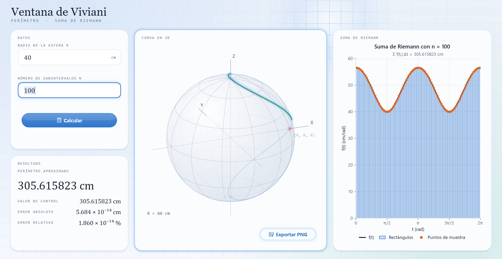

# Perímetro de la Ventana de Viviani

Proyecto de Cálculo Vectorial (ESPOL, PAO II 2026-2027). El programa aproxima el
perímetro de la Ventana de Viviani generada por una esfera de radio R (en cm),
mediante una suma de Riemann de la función subintegral de la longitud de arco.

Hay dos versiones que hacen el mismo cálculo:

- **Aplicación de escritorio** (`viviani_app.py` o el `.exe`): tema oscuro, con la
  curva en 3D girando, los rectángulos de la suma animados y efectos de sonido.
- **Versión de consola** (`perimetro_viviani.py`): el núcleo matemático, sin
  librerías externas.



## Fundamento matemático

Parametrización de la curva (t ∈ [0, 2π]):

    r(t) = (R cos²t, R sen t cos t, R sen t)

Longitud de arco:

    L = ∫₀^{2π} ‖r′(t)‖ dt = ∫₀^{2π} R √(1 + cos²t) dt

La integral no tiene antiderivada elemental, por lo que se aproxima con

    L ≈ Σ f(tᵢ) Δt,    Δt = 2π / n,    f(t) = R √(1 + cos²t)

tomando tᵢ en el punto medio de cada subintervalo.

Valor de control: L = 4√2 · R · E(1/2) ≈ 7.640395578 · R, donde E es la
integral elíptica completa de segunda especie (verificado con scipy).

## Usar el ejecutable

No necesita Python. Descomprima `PerimetroViviani-onedir.zip` y abra
`PerimetroViviani\PerimetroViviani.exe` (o use el archivo único
`PerimetroViviani.exe`).

1. Escriba el radio R (cm) y el número de subintervalos n.
2. Presione **Enter** o **Calcular**.
3. Para encadenar otro cálculo, escriba el nuevo valor y vuelva a presionar Enter.

| Tecla | Acción |
|---|---|
| Enter | Calcular |
| Esc | Cancelar el cálculo en curso o saltar la animación |

Windows SmartScreen o el antivirus pueden avisar al abrir un `.exe` que no está
firmado (es un falso positivo frecuente con PyInstaller). Si ocurre, elija
"Más información → Ejecutar de todas formas".

## Instalar para desarrollo

Requiere Windows y Python de 64 bits. Se desarrolló y probó solo con Python 3.15.

```powershell
.\scripts\ejecutar.ps1
```

La primera vez crea el entorno virtual `.venv` e instala las dependencias de
`requirements-dev.txt` (versiones fijadas; la lista completa congelada está en
`requirements-lock.txt`). Después abre la aplicación.

Equivalente a mano:

```powershell
python -m venv .venv
.venv\Scripts\python.exe -m pip install -r requirements-dev.txt
.venv\Scripts\python.exe viviani_app.py
```

Versión de consola (no necesita nada instalado):

```powershell
python perimetro_viviani.py
```

## Probar

```powershell
.venv\Scripts\python.exe -m unittest -v
.venv\Scripts\ruff.exe check .
```

Las pruebas comprueban, entre otras cosas, que L/R = 7.640395578, que la versión
rápida (numpy) coincide con la de consola y todos los mensajes de validación.

## Construir el ejecutable

```powershell
.\scripts\construir.ps1              # los dos modos
.\scripts\construir.ps1 -Modo onedir
.\scripts\construir.ps1 -Modo onefile
```

Primero ejecuta las pruebas; si pasan, construye con PyInstaller según
`viviani.spec` y deja el resultado en `dist\` (que no se sube a git).

Medido en un portátil con Windows 11 (2026-11-19):

| Modo | Resultado | Tamaño | Pantalla de carga | Ventana lista |
|---|---|---|---|---|
| Carpeta (`onedir`) | `dist\PerimetroViviani\` | 104.9 MB (45.7 MB en zip) | 0.5 s | 2.3 s |
| Archivo único (`onefile`) | `dist\PerimetroViviani.exe` | 45.5 MB | 1.9 s | 3.8 s |

El archivo único tarda más en mostrar algo porque primero se descomprime en
una carpeta temporal (eso ocurre antes de que el programa pueda dibujar).

El icono del `.exe` sale de `src/viviani/recursos/icono.ico`; si se cambia el
logo (`src/viviani/ui/logo.py`), se regenera con
`.venv\Scripts\python.exe scripts\generar_icono.py`.

Para grabar el video conviene el modo carpeta (abre más rápido). Para entregar
o enviar, el archivo único es más cómodo; el zip del modo carpeta suele dar
menos avisos del antivirus, porque el archivo único se descomprime en una
carpeta temporal cada vez que se abre.

## Versiones

| Versión | Dónde está | Aspecto |
|---|---|---|
| 1.0 | etiqueta `v1.0` (rama `feature/interfaz-grafica`) | Tema claro con tarjetas |
| 2.0 | rama `version-2` | Tema oscuro grafito; la curva 3D ocupa el centro, resultados y Riemann juntos a la derecha, créditos con efecto vidrio, pantalla de carga e icono |

Para volver a la versión 1: `git checkout v1.0` (y `git checkout version-2`
para regresar).

## Estructura

| Ruta | Contenido |
|---|---|
| `perimetro_viviani.py` | Núcleo matemático y versión de consola |
| `test_perimetro_viviani.py` | Pruebas del núcleo |
| `viviani_app.py` | Lanzador de la aplicación de escritorio |
| `src/viviani/` | Código de la aplicación (cálculo, gráficas, sonido, interfaz) |
| `tests/` | Pruebas de la aplicación |
| `scripts/` | `ejecutar.ps1`, `construir.ps1` y `generar_icono.py` |
| `docs/EXPLICACION.md` | Cómo está organizado el código, en lenguaje sencillo |
| `docs/decisiones.md` | Por qué se eligió PySide6 + matplotlib |
| `viviani.spec` | Receta de PyInstaller |

## Integrantes

- Darlyn Acosta
- Juan Carrasco
- Juan Espinoza
- Mateo Saltos

Profesora: Dra. Soveny Solís
